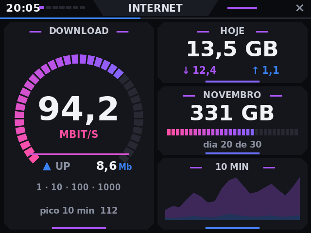
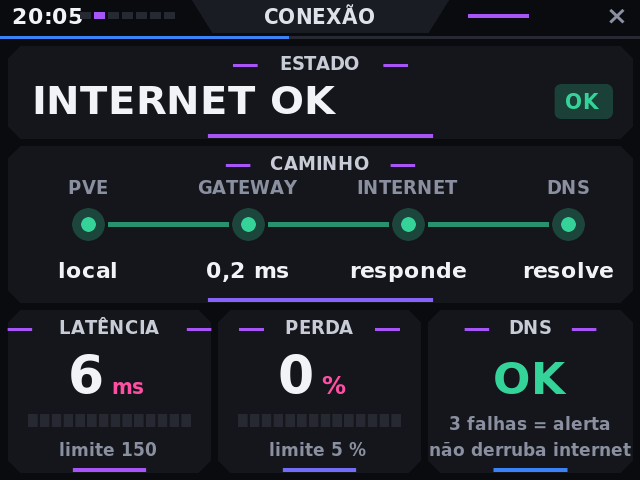
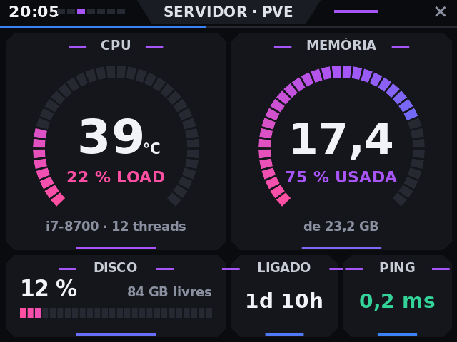
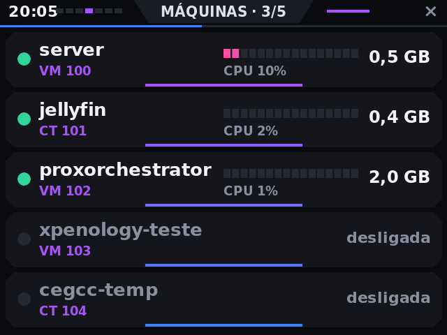
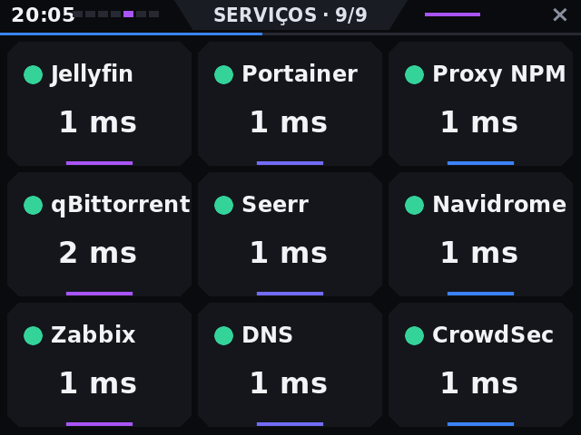
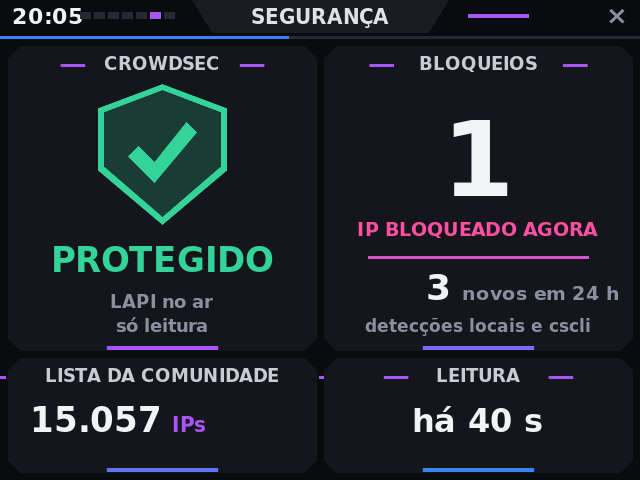
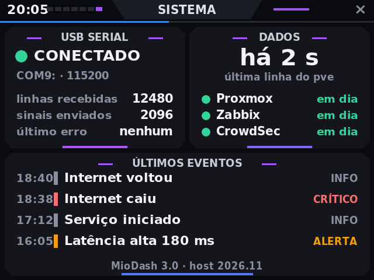
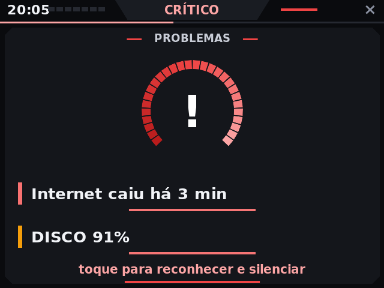
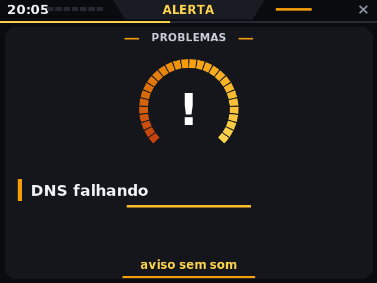
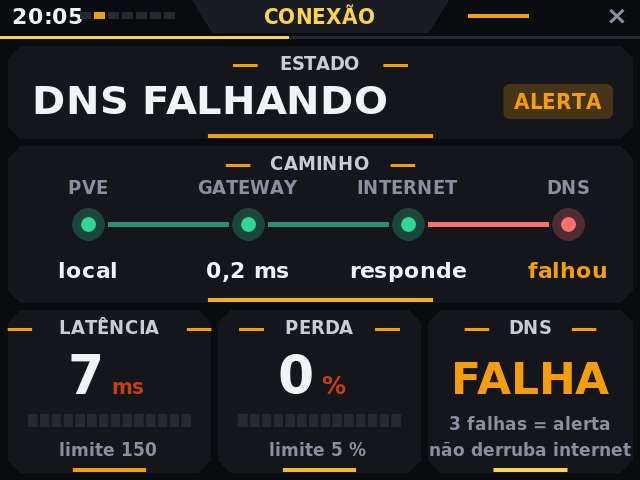

# Mio USB Dashboard

Transforma o GPS **Mio DigiWalker C250 Plus** (Samsung S3C2440 / ARM920T, 64 MB, 320x240, Windows CE Core 5.0) numa central física de **monitoramento do homelab** (Proxmox, internet, VMs, serviços e CrowdSec), ligada pelo **cabo USB**. Só leitura em tudo, sem root e sem nada exposto na rede.

> **Linux/Proxmox:** testado e em uso. **Windows:** experimental, nunca testado num PC com Windows. Veja [Windows (experimental)](#5-windows-experimental). Se você tem uma IA de programação, ela pode ajudar a terminar e testar essa parte.

```
mio-usb-dashboard/
├── host/                     → roda no Proxmox/Linux
│   ├── server.py             coletor + envio pela serial USB (+ HTTP opcional, só local)
│   ├── fonte_zabbix.py       internet da casa (WAN do OPNsense) lida do Zabbix
│   ├── fonte_pve.py          VMs/CTs (API do PVE com token só leitura) e serviços por TCP
│   ├── fonte_rede.py         diagnóstico: gateway, internet, DNS, latência e perda
│   ├── fonte_crowdsec.py     CrowdSec pela LAPI (chave de bouncer, só leitura)
│   ├── eventos.py            últimos eventos (alerta subiu/desceu) para a tela Sistema
│   ├── transporte.py         envio ao Mio: /dev/mio (Linux), COMx ou USB direto (libusb)
│   ├── config.windows.json   exemplo de config para Windows (experimental)
│   ├── fonte_internet.py     teste de queda da internet (ping) e horário de silêncio
│   ├── simular_queda.sh      simula queda e volta da internet (para testar o alarme)
│   ├── test_*.py             testes: python3 -m unittest (em host/)
│   ├── config.json           serviços, Zabbix, limites de alerta, porta serial
│   ├── setup_usb_serial.sh   driver ipaq + /dev/mio  (caminho REAL do C250)
│   ├── setup_usb_net.sh      RNDIS 192.168.55.1/24 + NAT opcional (para ROM com RNDIS)
│   └── mio-dashboard.service unidade systemd
├── device/                   → programa nativo do Mio (C, Win32 CE)
│   ├── mio_dash.c            lê a COM9 e desenha o painel
│   ├── Makefile              compila com CeGCC (arm-mingw32ce-gcc)
│   └── gatilho.mscr.modelo   modelo dos gatilhos de inicialização
└── sdcard/                   → copiar para a RAIZ do cartão SD
docs/telas-mio-v3.html        → desenho atual das telas (7 telas + alerta em 2 níveis)
SECURITY.md                   → controles de segurança e limitações
```

## Telas

Tema Neon, 320x240. Cada tela fica `tempo_tela` segundos (padrão 20) e um toque passa para a próxima. São 7 telas na rotação, e a de alerta entra quando há problema.

| Internet (OPNsense via Zabbix) | Conexão (diagnóstico) |
|---|---|
|  |  |
| **Servidor (Proxmox)** | **Máquinas (VMs e CTs)** |
|  |  |
| **Serviços** | **Segurança (CrowdSec)** |
|  |  |
| **Sistema (USB, fontes, eventos)** | **Alerta crítico** (vermelho, apita; um toque reconhece) |
|  |  |
| **Alerta âmbar** (só aviso, sem som) | **Conexão com DNS falhando** |
|  |  |

> Imagens geradas a partir do desenho `docs/telas-mio-v3.html` com números de exemplo
> (`node docs/telas/gerador/gerar.js docs/telas-mio-v3.html <pasta> "DejaVu Sans"` + ImageMagick).
> No aparelho a fonte é Tahoma e algumas posições variam um pouco.

## Compatibilidade

**Testado de verdade: só o Mio DigiWalker C250 Plus** (Windows CE 5.0 Core, ARM920T, 320x240).
No Linux ele aparece como `3340:043a` "Yakumo Mio A701 DigiWalker": é só o nome que a lista de
IDs USB dá para esse código, não outro modelo testado.

### Requisitos do aparelho

1. **Windows CE** (4.2, 5.0 ou 6.0). GPS com outro sistema **não funcionam** (TomTom, Garmin e
   similares).
2. **Processador ARM**, que é o caso de quase todo GPS com Windows CE.
3. **Porta serial pela USB**: o aparelho precisa expor a USB como uma porta COM (no C250 é a
   `COM9:`). Aparelhos que só ligam no PC como pendrive não servem.
4. **Tela 320x240.** Em outra resolução o programa roda, mas o painel ocupa só um canto até o
   desenho ser adaptado (as posições estão fixas em 320x240).

### O que muda em outros aparelhos

| Parte | Situação | Ajuste |
|---|---|---|
| `MioDash.exe` | Só usa a API básica do CE (`COREDLL`); deve rodar em ARM com CE 5/6 | Outra porta: `MioDash.exe COM3:` (ou `PORTA_SER` no `MioAutoRun.mscr`) |
| Tela | Só 320x240 | Outras resoluções (480x272, 800x480) precisam de adaptação no `mio_dash.c` |
| Liberar a porta | Fecha `MutDevice*.exe` (Mio/Mitac) e `repllog`/`rapiclnt`/`rnaapp` (ActiveSync) | Outras marcas podem ter outro programa segurando a porta |
| Gatilho do cartão | No C250 o firmware roda `\Storage Card\Oscar91ADM.exe` | Os gatilhos `autorun`, `GOCE` e `2577\autorun` estão no kit, **não testados** |
| Host (Linux/Proxmox) | Driver `ipaq` do kernel | Outro VID:PID precisa entrar no `setup_usb_serial.sh` |

### Candidatos mais prováveis (não testados)

- **Mio/Mitac com Windows CE da mesma época** (séries C, P e Moov): mesmo fabricante, mesmo tipo de
  USB e o mesmo `MutDevice`.
- **Navman, Medion, Becker, Airis e GPS genéricos chineses com Windows CE**: podem funcionar, mas
  em cada um é preciso descobrir qual programa o firmware executa ao inserir o cartão e qual porta
  COM é a da USB.

Se testar em outro aparelho, abra uma issue com o modelo, a resolução, a porta COM e o que
aconteceu.

## Arquivos de terceiros (não estão no repositório)

O kit do cartão usa programas de terceiros para Windows CE que **não são redistribuídos aqui**.
Baixe de suas fontes oficiais e coloque nos caminhos abaixo (só o `MortScript.exe` é obrigatório;
os demais servem ao menu de manutenção):

| Arquivo | Onde vai no cartão | Para quê |
|---|---|---|
| MortScript 4.2 (`MortScript.exe` + launcher `autorun.exe`) | raiz, `2577\`, `MioAutoRun\` e cópias do launcher como `Oscar91ADM.exe`, `GOCE.exe`, `MioAutoRun\MioAutoRun.exe` | roda os `.mscr` (o C250 executa `\Storage Card\Oscar91ADM.exe` ao inserir o cartão) |
| Oscar91ADM (gerenciador de arquivos) | `MioAutoRun\Apps\Oscar91ADM.exe` | "Abrir arquivos" no menu |
| iTaskMgr, Resinfo | `MioAutoRun\Tools\` | lista de processos, informações do sistema |
| Total Commander CE, File Manager CE | `MioAutoRun\Apps\...` | opcionais (não abrem no C250) |

O `MioDash.exe` (deste projeto) já vem compilado em `sdcard/MioAutoRun/Apps/`.

## Estado atual (20/11/2026, funcionando)

- **Rodando:** serviço `mio-dashboard` no pve (192.168.1.11), em `/opt/mio-usb-dashboard/host`, liga sozinho no boot. Mio na USB do pve → `/dev/mio` (driver `ipaq` do kernel + regra udev `99-mio-c250.rules`).
- **Telas (tempo em `tempo_tela` no config.json, hoje 20 s; toque avança, × fecha):** Internet, Servidor, Máquinas, Serviços e Alerta (só com alerta; o tema fica vermelho).
- **Internet:** Zabbix em `http://192.168.1.10:8086`, usuário **`mio-painel` só leitura** (grupo `mio-painel`, leitura no grupo Network), token em `/etc/mio-dashboard/zabbix.token` (600, dono `mio-painel`) no pve. Itens do host `opnsense`: velocidade `net.if.in/out[igc0,bytes]` (53638/53639, a cada 10 s, tag `uso=mio-painel`); consumo hoje/mês somado de `net.if.in/out[igc0]` (50871/50879, trends + histórico, fuso Europe/Rome). Arco de download em escala log 1–1000 Mbit/s.
- **COM9 do Mio:** quem segura a porta é o **`MutDevice*.exe`** (serviço da Mitac). O MioDash fecha esse processo (via `toolhelp.dll`) quando a abertura dá erro 12/32 e tenta de novo; vale até o reset do Mio. A ROM **não tem** Serial_Class, Mass_Storage, TCP/IP nem PPP (por isso o ActiveSync nunca funcionou).
- **Tirar/pôr o cartão derruba a USB do Mio** por alguns segundos; o MioDash reconecta sozinho.
- **Compilar:** CeGCC 9.3.0 (MaxKellermann/cegcc-build) em `/opt/cegcc` de um LXC temporário; `make` em `device/`. O exe só importa COREDLL.

### Alarme quando a internet cai
- O pve pinga `1.1.1.1` e `8.8.8.8` a cada 10 s; se **os dois falharem 3 vezes seguidas** (~30 s), manda `net=0`
  e o alerta "Internet caiu há N min".
- O Mio apita **3 bips a cada 10 s** (som gerado na memória, volume no máximo). **Um toque silencia** até a
  internet voltar. Na volta toca um **bip duplo de "tudo certo"**.
- **Silêncio das 23h às 7h**: mostra o alerta sem som.
- Tudo no `config.json`: `"internet_teste": {"alvos": [...], "falhas": 3, "som": true, "silencio": "23-7"}`.
- Testar sem derrubar a internet: `host/simular_queda.sh [segundos]` troca os alvos por `192.0.2.1`
  (endereço que nunca responde), espera e volta a configuração. No pve:
  `systemd-run --unit mio-simula --collect /opt/mio-usb-dashboard/host/simular_queda.sh 45`
  (45 s = ~15 s de alarme e depois o bip de volta; padrão 90 s).

### Campos novos da linha serial
`wok` (1/0), `wd`/`wu` Mbit/s, `wg` 20 pares `down/up` 0–99, `wm` máximo do gráfico, `hd hu ht` hoje, `md mu mt` mês, `mes dia ndias`, `vm1..vm6 = nome;VM 100;1;18%;9,1 GB`, `nvm`, `sv1..sv9 = nome;1;ms`, `nsv`, `rot` (segundos por tela),
`net` (1/0) e `som` (1 = pode apitar). A linha vai em cp1252 (página de código do Mio). Valores nunca têm `|`; linha ≤ 2048 bytes.

### Telas e alertas v3 (bloco 3)
Desenho: [`docs/telas-mio-v3.html`](docs/telas-mio-v3.html). São 7 telas na rotação: Internet, **Conexão**, Servidor, Máquinas, Serviços, **Segurança** e **Sistema**. A tela de alerta entra quando há problema.

| Nível | Tema | Som | Exemplos |
|---|---|---|---|
| Crítico (`2`) | vermelho | 3 bips a cada 10 s; um toque reconhece | internet, gateway, Proxmox sem dados, CrowdSec parado, temperatura |
| Alerta (`1`) | âmbar | nenhum | DNS, perda, latência, CPU, RAM, disco, serviço fora, VM importante desligada, Zabbix ou CrowdSec sem leitura |
| Info (`0`) | n/d | nenhum | só em "Últimos eventos" (internet voltou, Mio conectado, serviço iniciado) |

- **Reconhecer:** o host manda `aid`, que é o id do conjunto de críticos ativos. Um toque silencia esse conjunto. Se surgir outro crítico, o `aid` muda e o Mio volta a apitar. Quando os críticos acabam, o Mio toca o bip duplo de "voltou ao normal".
- **Eventos:** um evento só nasce quando um alerta aparece ou some. Se o mesmo alerta voltar em menos de 5 min, não gera outro par de eventos. Ficam os últimos 20 em `/var/lib/mio-dashboard/eventos.json`, também no journal (`evento: CRÍTICO Internet caiu`). O Mio mostra os 4 últimos.
- **VMs importantes:** `"maquinas_importantes": ["server", "jellyfin", "proxorchestrator"]` no `config.json`. Desligada vira alerta âmbar.

Campos novos: `alv` (níveis alinhados com `alr`), `bip` (1/0), `aid`, `ev` (`hh:mm,nível,texto;...`), `ver`. O bloco 2 vai agrupado: `cn = gw;dns;lat;per;nst;nlv;limite_lat;limite_perda` e `cs = estado;bloqueados;novos24h;lista;idade_s`. A linha real tem 51 campos e cerca de 800 bytes (o Mio aceita 64 campos e 2048 bytes). O MioDash v2 continua funcionando com o host v3, porque `net`, `som` e `alr` não mudaram.

### Diagnóstico da internet, CrowdSec e dados velhos (bloco 2)
O host manda estes valores agrupados em `cn` e `cs` (ver acima). O Mio v3 os mostra nas telas Conexão e Segurança.

| Campo | Significado |
|---|---|
| `gw` | 1/0, o gateway (OPNsense pela LAN) responde ao ping |
| `lat` | latência média em ms até 1.1.1.1/8.8.8.8 (últimas 6 rodadas, ~1 min) |
| `per` | % de perda de pacotes (últimas 20 rodadas; queda total não conta como perda) |
| `dns` | 1/0, o DNS do sistema resolve (3 falhas seguidas = 0) |
| `nst` | `ok`, `gw` (gateway fora), `net` (internet fora: WAN ou provedor), `dns`, `perda`, `lat` |
| `nlv` | 0 OK, 1 ALERTA, 2 CRÍTICO |
| `cs` | CrowdSec: 1 no ar, 0 LAPI fora, `e` no ar mas sem leitura (chave/rede) |
| `csb` `csn` `csl` | IPs bloqueados por decisões locais, decisões locais novas em 24 h, decisões da lista comunitária |
| `old` | fontes sem leitura boa há mais de max(3 × período, 60 s): `pve`, `zabbix`, `crowdsec` |

- **DNS:** a falha só de DNS nunca vira "internet caiu". No pve o `auto` usa o primeiro `nameserver` de `/etc/resolv.conf` (192.168.1.1). Como o OPNsense redireciona toda consulta na porta 53 para o Unbound, na prática o teste mede o Unbound.
- **WAN:** o pve não sabe se o cabo da WAN caiu ou se é o provedor. Os dois aparecem como `net`. Separar exigiria a API do OPNsense.
- **Alertas novos** (texto em `alr`): `Gateway sem resposta`, `DNS falhando`, `Perda de pacotes N%`, `Latência alta N ms`, `CrowdSec parado`, `CrowdSec sem leitura`, `Sem dados: Proxmox/CrowdSec`. Limites em `limites.latencia` (150 ms) e `limites.perda` (5 %).
- **CrowdSec:** chave de bouncer (`cscli bouncers add mio-painel -o raw` no contêiner) em `/etc/mio-dashboard/crowdsec.key` (600). Config `"crowdsec": {"url": "http://IP:8088", "chave_arquivo": ..., "estado": "/var/lib/mio-dashboard/crowdsec-vistos.json"}`. A lista comunitária (~2 MB) é lida no máximo a cada 30 min.

---

## 0. O que já foi verificado no aparelho (20/11/2026)

| Item | Resultado no C250 Plus |
|---|---|
| Gatilho do cartão | ✅ o firmware executa **`\Storage Card\Oscar91ADM.exe`** ao **inserir o cartão com o aparelho ligado**. No kit, ele é o launcher do MortScript e abre o painel direto. Não precisa de hard reset |
| MortScript 4.2 | ✅ funciona. Texto se compara com `eq`/`ne` (com `=` dá erro) |
| Gravar no cartão | ❌ o Mio monta o SD só leitura: nada é gravado no cartão |
| **RNDIS (rede USB)** | ❌ **não existe na ROM** ("O driver USB 'RNDIS' não existe nesta imagem") |
| Navegador `iesample.exe` | ❓ não verificado (provavelmente não existe: nem `explorer.exe` existe) |
| Portas | `COM2:` = GPS interno, `COM1:` = TMC, **`COM9:` = serial pela USB** |
| USB no PC | aparece como **"Mio DigiWalker USB Sync"**, VID `3340` PID `043A`, classe FF |
| ActiveSync (Windows) | driver instala, mas o Mio nunca completa a conexão |
| Total Commander / File Manager CE | ❌ não abrem. **Oscar91ADM** (em `MioAutoRun\Apps`) funciona |

**Consequência:** o modo pedido originalmente (RNDIS + navegador em `192.168.55.1:8080`) **não roda neste C250**. O projeto tem os dois modos:

- **Modo serial (C250):** `server.py` manda uma linha de texto a cada 2 s para `/dev/mio` (a COM9 do Mio pela USB). O `MioDash.exe` no Mio desenha o painel.
- **Modo web/RNDIS:** as páginas HTML 4.01 de 320x240 em `:8080` continuam disponíveis. Servem para ver no navegador do PC e para outro aparelho ou ROM que tenha RNDIS.

**O que ainda não foi testado:** `server.py` no Linux, a compilação e execução do `mio_dash.c` no Mio, e a passagem de dados pela COM9 ↔ `/dev/ttyUSB0`.

---

## 1. Host (Proxmox)

Copie a pasta para o servidor, por exemplo em `/opt/mio-usb-dashboard`:

```bash
# de qualquer máquina com o repositório, ajuste o IP do Proxmox:
git clone https://github.com/nutersamsu/mio-usb-dashboard
scp -r mio-usb-dashboard root@IP_DO_PROXMOX:/opt/
```

No Proxmox:

```bash
cd /opt/mio-usb-dashboard/host
chmod +x *.sh

# 1) testar a coleta (sem servidor):
python3 server.py --once

# 2) ajustar serviços/limites/porta:
nano config.json
#    "servicos": [{"nome":"SSH","check":"tcp:127.0.0.1:22"}, {"nome":"PVE","check":"systemd:pveproxy"}, ...]
#    "serial": {"ativo": true, "porta": "/dev/mio"}

# 3) ligar o Mio na USB do servidor e preparar a serial:
./setup_usb_serial.sh --udev      # carrega 'ipaq', ensina o PID 3340:043a, cria /dev/mio

# 4) rodar:
python3 server.py                 # serial; web só se "http": true (em 127.0.0.1:8080 por padrão)

# 5) usuário próprio, credenciais só leitura e serviço (sem root):
useradd --system --no-create-home --home-dir /nonexistent --shell /usr/sbin/nologin mio-painel
install -d -m 700 -o mio-painel -g mio-painel /etc/mio-dashboard
install -m 644 /etc/pve/pve-root-ca.pem /etc/mio-dashboard/
pveum user add mio@pve --comment "Mio USB Dashboard - so leitura"
pveum acl modify / --users mio@pve --roles PVEAuditor
umask 077; pveum user token add mio@pve painel --privsep 0 --output-format json \
  | python3 -c "import json,sys; d=json.load(sys.stdin); print(d['full-tokenid']+'='+d['value'])" \
  > /etc/mio-dashboard/pve.token
#    (opcional) token do Zabbix em /etc/mio-dashboard/zabbix.token
chown mio-painel:mio-painel /etc/mio-dashboard/*.token; chmod 600 /etc/mio-dashboard/*.token
#    no config.json: "proxmox_api": {"url": "https://127.0.0.1:8006",
#                     "token_arquivo": "/etc/mio-dashboard/pve.token",
#                     "ca": "/etc/mio-dashboard/pve-root-ca.pem"}
cp mio-dashboard.service /etc/systemd/system/
systemctl daemon-reload && systemctl enable --now mio-dashboard
journalctl -u mio-dashboard -f
```

- **Coleta:** usa só a biblioteca padrão. O `psutil` é opcional: `apt install python3-psutil`. Sem ele, os dados vêm de `/proc` e `/sys`.
- **Rede:** a interface `auto` é a da rota padrão (no Proxmox, normalmente `vmbr0`). O ping `auto` vai para o gateway.
- **Proxmox:** com `"proxmox": true`, ele conta as VMs e CTs rodando (`qm list` / `pct list`).
- **Alertas:** CPU > 85 %, RAM > 90 %, disco > 90 %, temperatura > 85 °C, 3 pings seguidos perdidos, ou serviço OFF. Com alerta ativo, a tela fixa em vermelho até normalizar.
- **Segurança:** ver [SECURITY.md](SECURITY.md). O serviço roda como `mio-painel` (grupo `dialout` para a serial), lê o Proxmox pela API com token `PVEAuditor` e sai com código 78 se o `config.json` for inválido (o systemd não fica reiniciando).
- **Vistas web:** desligadas no pve (`"http": false`). Com `"http": true`: `/?view=sys` → `net` → `alert`, trocando por `<meta refresh>` a cada 5 s. Há também `/api` (JSON).

### Protocolo serial (host → Mio)
Uma linha ASCII a cada `intervalo` segundos, a 115200 8N1:
```
D|h=17:45:02|host=pve|cpu=12|ram=48|ramu=7800|ramt=16000|dsk=61|dskl=180.2|tmp=47|up=3d 04h12m|if=vmbr0|rx=120.4|tx=33.1|png=1.2|svc=SSH:1,PVE:1,PG:0|alr=PG OFF|vm=3/5|ct=2/4
```

### Testar a serial sem o servidor
```bash
lsusb -d 3340:          # deve listar 3340:043a
ls -l /dev/mio /dev/ttyUSB*
echo 'D|h=teste|host=pve|cpu=42|ram=50|dsk=10|tmp=40|up=1d|svc=SSH:1|alr=' > /dev/mio
```

---

## 2. Compilar o cliente do Mio (`device/`)

O Mio precisa de um executável **ARM / Windows CE** (PE `0x1c0`), compilado com **CeGCC** (`arm-mingw32ce`). Recomendo fazer isso num **contêiner LXC Debian** do Proxmox, e não no próprio host.

```bash
# Opção A: toolchain pronto (CeGCC 0.59.1, binário Linux 32 bits, antigo):
#   https://sourceforge.net/projects/cegcc/files/cegcc/0.59.1/
#   precisa de libs i386:  dpkg --add-architecture i386 && apt update && apt install libc6:i386 zlib1g:i386
#   extrair em /opt/mingw32ce  e  export PATH=/opt/mingw32ce/bin:$PATH
#
# Opção B: compilar o fork mantido (GCC mais novo):
#   https://github.com/MaxKellermann/cegcc-build   (siga o README dele)

cd /opt/mio-usb-dashboard/device
make            # gera MioDash.exe
make instalar   # copia para ../sdcard/MioAutoRun/Apps/
file MioDash.exe   # deve dizer: PE32 executable (GUI) ARM ... Windows CE
```

No Mio, o `MioDash.exe`:
- abre a `COM9:` (pode trocar pela linha de comando: `MioDash.exe COM3:`);
- mostra **SEM DADOS** enquanto não chega nada;
- tocar na tela troca a vista, e tocar no **canto superior direito** fecha;
- chama `SystemIdleTimerReset()` a cada 10 s para a tela não apagar.

Esses links e o código **não foram testados**. Se der erro de compilação, ajuste o `mio_dash.c`: ele usa só a API básica do `coredll`.

### Fonte de pixel (desde 21/11/2026)

O texto não usa mais a Tahoma da ROM (ficava borrada em 9–11 px na tela 320×240). O `MioDash.exe` traz uma **fonte de pixel embutida**, derivada da Terminus Font de Dimitar Zhekov (SIL Open Font License 1.1, texto em `device/fontes/OFL-Terminus.txt`). Ela foi recortada para ficar proporcional, e os tamanhos pequenos ganharam negrito sintético. Os tamanhos grandes são a mesma fonte ampliada em pixels inteiros. Com isso o exe passou de ~44 KB para ~117 KB.

- `device/fontes_pixel.h` é **gerado**. Para mudar tamanhos ou caracteres, edite a tabela `TAMANHOS`/`CARACTERES` em `device/fontes/gerar_fontes.py` e rode:
  `python3 device/fontes/gerar_fontes.py <pasta com Uni2-Terminus*.psf.gz> device/fontes_pixel.h`
  (os `.psf.gz` vêm do pacote `console-setup-linux` do Debian: `apt-get download console-setup-linux && dpkg-deb -x ...`).
- `device/fontes/previa.py` desenha as telas do mockup com a fonte nova, sem precisar do aparelho. As imagens ficam em `docs/telas/fonte-pixel/`.
- O exe anterior, com a Tahoma, continua funcionando: o código antigo está no histórico do git.

---

## 3. Cartão SD (`sdcard/`)

- Cartão **SD padrão de até 2 GB**. **SDHC (4 GB ou mais) não funciona** no S3C2440.
- **FAT32 ou FAT16**, uma partição, tabela MBR. O cartão atual de 1 GB em FAT32 funciona.
- Copie o **conteúdo** de `sdcard/` para a **raiz** do cartão. A pasta `MioMap` com as músicas pode ficar.
- Depois de compilar, coloque o `MioDash.exe` em `MioAutoRun\Apps\`.

**Uso:** com o Mio **ligado**, **insira o cartão**. Aparece "Mio Dashboard" com 5 s para escolher:
- **Dashboard** (padrão): fecha o `MioMap.exe`, desliga o apagamento da tela no registro e abre:
  - o navegador `iesample.exe` em `http://192.168.55.1:8080/?view=sys`, **se** a ROM tiver RNDIS e navegador (configura `RNDISFN1` com `192.168.55.2/24` e gateway `.1`);
  - senão, o `MioDash.exe` na `COM9:` (modo serial);
  - se nenhum dos dois existir, uma mensagem e o menu.
- **Menu de manutenção:** o menu completo (gerenciador de arquivos, portas COM, diagnóstico, modo USB, navegação original).

Para voltar ao normal, aperte o **reset** (furinho) ou tire o cartão e reinicie. Nada é instalado na flash interna. As chaves de registro são desfeitas por um hard reset.

---

## 4. Problemas comuns

| Sintoma | O que fazer |
|---|---|
| `lsusb` não mostra `3340:` | Cabo só de carga, ou Mio desligado. Use o cabo original |
| Mio aparece mas não cria `/dev/ttyUSB*` | `modprobe ipaq; echo 3340 043a > /sys/bus/usb-serial/drivers/ipaq/new_id`; veja o `dmesg` |
| `/dev/mio` existe mas o Mio mostra SEM DADOS | Confirme `"serial": {"ativo": true}` e se o `MioDash.exe` está aberto antes de enviar. Teste com `echo 'D|...' > /dev/mio`. No Mio, o menu → "Listar portas COM" deve mostrar `COM9: Drivers\BuiltIn\USB` |
| A COM9 não recebe nada | O modo USB do Mio pode estar diferente: menu → "Modo USB..." → "Porta serial (Serial_Class)" e reconecte o cabo |
| ROM sem RNDIS (caso do C250) | Use o modo serial. Para conferir outra ROM: menu → "Diagnóstico do sistema", ou no registro `HKLM\Drivers\USB\FunctionDrivers\RNDIS` |
| Erro do MortScript "Comparing two string values..." | Troque `=` por `eq` e `<>` por `ne` na linha indicada |
| "Couldn't write file" | O SD está só leitura no Mio: não grave no cartão |
| Tela apaga mesmo assim | O gerenciador de energia da Mio pode ignorar o registro. O `MioDash.exe` mantém a tela acesa enquanto estiver aberto |

## 5. Windows (experimental)

> **Não testado num PC com Windows.** O código foi preparado e tem testes automáticos que simulam
> a saída do Windows, mas ninguém rodou num Windows de verdade ainda. Se você testar, abra uma
> *issue* contando o que deu certo e o que falhou.

O programa do Mio (`MioDash.exe`) é o mesmo. O que muda é o lado do computador (`host/`).

**O que já foi adaptado:**
- **Métricas:** sem `/proc`, CPU, memória, disco, tempo ligado e tráfego vêm do `psutil`. Comparei com o Linux simulando um sistema sem `/proc` e os números bateram. A temperatura não aparece no Windows (o `psutil` não lê sensores lá).
- **Ping:** lê a saída do `ping` do Windows pelo `TTL=` de cada resposta, que é igual em português, italiano ou inglês. O código de saída do `ping` do Windows não é confiável: ele devolve sucesso até para "host de destino inacessível".
- **Gateway:** sai do `route print -4 0.0.0.0`. Já o tráfego é a soma de todas as placas de rede.
- **Envio ao Mio:** além do `/dev/mio` do Linux, há dois modos novos em `"serial": {"porta": ...}`:
  - `"usb"`: fala com o Mio direto pela USB (libusb), fazendo o mesmo que o driver `ipaq` do Linux: interface 0, comando de controle `0x22`, escrita no endpoint `0x04`, leitura no `0x81`.
  - `"COM5"` (ou outra): se algum driver criar uma porta COM para o Mio.
- **Serviços:** só `tcp:host:porta` (o `systemd:` não existe no Windows).

**Como tentar:**
1. Instale o [Python 3](https://www.python.org/downloads/) e rode `pip install psutil pyusb`. Para o modo COM, rode também `pip install pyserial`.
2. Ligue o Mio na USB. Com o [Zadig](https://zadig.akeo.ie/), escolha "Mio DigiWalker USB Sync" (`3340:043A`) e instale o driver **WinUSB**. Isso troca o driver desse aparelho no seu PC; dá para desfazer pelo Gerenciador de Dispositivos.
3. Copie `host\config.windows.json` para `host\config.json` e ajuste os serviços. Proxmox (`proxmox_api`), Zabbix e CrowdSec são opcionais e usam os mesmos tokens só leitura da seção 1.
4. Teste com `python server.py --once` e depois rode `python server.py`. Abra o `MioDash.exe` no Mio.
5. Para iniciar com o Windows, use o Agendador de Tarefas: "Ao iniciar o sistema", programa `pythonw.exe`, argumentos `C:\caminho\host\server.py --config C:\caminho\host\config.json`, com uma conta comum (sem administrador).
6. Proteja os tokens: guarde-os numa pasta só sua (`icacls pasta /inheritance:r /grant:r %USERNAME%:F`).

**O que pode dar errado:** o Zadig não mostrar o Mio, a libusb não achar o aparelho (`Mio nao encontrado na USB`) ou o Mio não aceitar o comando de abertura. Nesses casos, uma máquina virtual Linux (VirtualBox ou VMware) com o USB do Mio passado para ela funciona exatamente como a seção 1.

### Tem uma IA de programação? Ela pode terminar isso para você

Se você usa um assistente que roda comandos no seu PC (Claude Code, por exemplo), peça algo assim:

```text
Clone https://github.com/nutersamsu/mio-usb-dashboard e leia o README, principalmente
a seção "Windows (experimental)". Quero rodar o host/ no meu Windows com o Mio C250 ligado
na USB. Instale as dependências, me ajude a instalar o driver WinUSB no Mio com o Zadig,
rode os testes (python -m unittest em host/) e depois python server.py --once. Se algo
falhar, corrija o código e mantenha o Linux funcionando. No fim, me diga o que mudou
para eu abrir um pull request.
```

Mantenha os tokens fora do chat e do repositório, e revise os comandos antes de deixar a IA executar.
